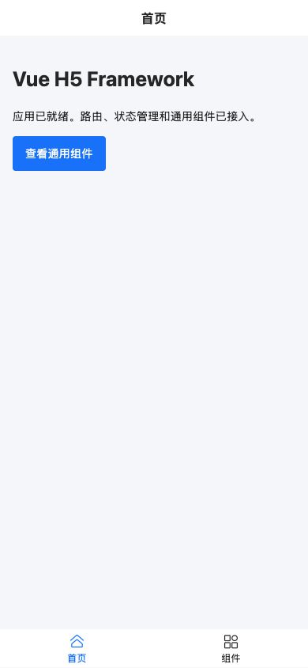
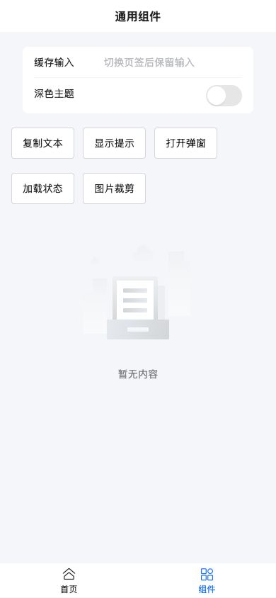

# Vue H5 Framework

通用移动网页起始框架，基于 Vue 3、Vite 6、Pinia、Vue Router 4、Vant 4 和 Axios。适用于独立移动浏览器页面，也提供可选的原生消息传输边界供新宿主接入。

首页和组件验证页无需账号、后端或原生容器即可运行。仓库不包含业务页面、业务接口/成功码、固定生产地址、品牌资源或原生业务 handler。

## 运行截图

2026-11-03 采集，来自源码版本 `f9ed8e8` 的本地生产构建，移动浏览器视口为 390 × 844 CSS px。首页和组件验证页直接运行，不依赖原生宿主或后端。

| 框架首页与底部导航 | 通用组件与外观设置 |
| --- | --- |
|  |  |

组件页可继续操作提示、弹窗、加载状态和图片裁剪；输入由页面缓存保留。

## 快速开始

环境：Node.js **22.12+**、npm。已使用 Node.js 22.21.1 验证；依赖由 `package-lock.json` 固定。

```sh
git clone https://github.com/wn228664/vue-h5-framework.git
cd vue-h5-framework
npm ci
npm run dev
```

默认地址为 `http://127.0.0.1:5174`，若端口被占用以 Vite 输出为准。首页 `/` 展示框架入口，`/components` 用于检查主题、缓存输入、提示、弹窗、加载和图片裁剪。

```sh
npm test             # Node 内置测试运行器
npm run build        # 生产构建，输出 dist/
npm run verify       # test → build
npm run build:stage  # staging 构建
npm run preview      # 预览已经构建的 dist/
```

preview 之前先执行 build。开发服务器默认只监听本机；需要手机局域网调试时可执行 `npm run dev -- --host 0.0.0.0`，并使用电脑的局域网地址访问。

## 能力清单

| 层级 | 已包含能力 |
| --- | --- |
| 应用与路由 | 懒加载、底部导航、KeepAlive、认证/权限守卫、安全返回、403/404、页面标题 |
| 状态 | Pinia、内存会话、权限列表、会话代次、主题偏好持久化 |
| 网络 | Axios 工厂、30 秒超时、signal 取消、带凭证请求目标约束、旧成功/失败隔离 |
| 页面组件 | NavigationBar、PopupTips、LoadingTransition、NetworkOffline、BackToTop |
| 图片 | 文件读取、方向/缩放处理、有限重试、图片裁剪、导出防重/超时/取消 |
| 浏览器与宿主 | 剪贴板兼容、全屏兼容、可取消的原生调用、可注销的原生回调 |
| 样式与构建 | Vant 按需导入、rem、安全区、亮/暗主题、gzip/brotli、图片优化、可选混淆 |

## 目录与依赖方向

```text
.
├── vite.config.js
├── .env.example
├── src/
│   ├── main.js / App.vue     # 初始化、全局主题与错误入口
│   ├── router/               # 路由、守卫、安全返回
│   ├── layouts/              # 底栏和缓存容器
│   ├── stores/               # UI、会话与权限
│   ├── api/                  # HTTP 工厂和注入实例
│   ├── components/           # 可复用 Vue 组件
│   ├── utils/                # Bridge、图片、存储、日期和浏览器能力
│   ├── styles/               # 公共布局、rem、安全区
│   └── views/                # 首页、组件验证、403/404
├── tests/                    # 网络、状态、工具与生命周期回归
└── docs/COMMON_COMPONENTS.md # 公开契约与清理责任
```

页面管理交互，通过 Pinia 与请求实例消费通用能力。共享组件只依赖属性、事件和通用工具；服务端业务信封由新项目的服务层解释。

## 环境配置

```sh
cp .env.example .env.local
```

| 变量 | 默认值 | 含义 |
| --- | --- | --- |
| `VITE_API_BASE_URL` | `/api` | API 基地址 |
| `DEV_PROXY_TARGET` | 未设置 | 开发代理目标；启用后移除 `/api` 前缀，仅影响开发服务器 |
| `VITE_BUILD_COMPRESS` | true | 输出 gzip/brotli 附件，部署服务器需另行启用对应能力 |
| `VITE_BUILD_IMAGE_OPTIMIZE` | true | 构建时优化导入图片和 public 图片 |
| `VITE_BUILD_OBFUSCATE` | false | 显式启用后混淆应用 chunk，跳过 vendor |
| `VITE_BUILD_DROP_CONSOLE` | production 为 true，其它模式为 false | 是否在构建中移除 console/debugger |

修改环境后重新启动或重新构建。VITE_* 会进入客户端代码，不用于保存服务密钥。默认没有生产代理或后台请求。

## 请求、认证与新页面

```js
import request from '@/api/request.js'
import { useSessionStore } from '@/stores/session.js'

useSessionStore().setSession({ token, permissions: ['example:view'] })
const controller = new AbortController()
const payload = await request.get('/items', { signal: controller.signal })
// 页面离开或新操作替代旧操作时 controller.abort()。
```

token 和 payload 由新项目的实际接口提供。默认认证请求只接受实例基地址下的相对路径，禁止覆盖 baseURL 或携带凭证请求任意外链。`authenticated: false` 用于公开传输，不自动注入 token 或触发会话清理；跨站目标仍由调用方控制。

成功返回原始 response.data；业务成功码和数据字段不由框架猜测。会话发生改变时，旧请求的成功和失败均拒绝为 `SESSION_CHANGED`，旧 401 不会清掉新登录。会话凭证默认只在内存中，页面刷新后需要新应用自行恢复认证。

新增页面在 `src/router/index.js` 注册懒加载路由；设置 `meta.title`、`meta.keepAlive`，需要时声明 `meta.requiresAuth` / `meta.permission`。权限不满足时进入 403；服务端仍需进行真实鉴权。缓存页的计时器、上传/解码、弹层与请求应在 deactivated 和卸载时清理，组件验证页包含对应写法。

## 常用封装怎么使用

| 封装 | 接入要点 |
| --- | --- |
| PopupTips | `v-model:show`、title/content/btnText、默认插槽；保留 ref.show；异步确认通过 Vant before-close 管理关闭 |
| ImageCropper | image 为 Data URL，ratio 默认 `[1, 1]`，confirm 输出非空 Blob；导出锁、超时、换图/停用失效已内置 |
| LoadingTransition | 纯展示层，默认显示，可通过 ref.show/hide 控制；请求和计时器由父级管理 |
| BackToTop | 默认监听 window；可通过 `target: () => HTMLElement` 指定组件滚动区域，替换/卸载自动移除监听 |
| NetworkOffline | 只提示浏览器连接状态，不证明互联网或服务端可达 |
| 图片归一化 | 最大 20MB；优先位图方向/缩放处理，始终释放解码资源；不支持位图解码时回退读取原图，缩放不作强保证 |
| 剪贴板与全屏 | 返回成功/失败或 Promise 拒绝，调用方负责用户手势、权限失败与按钮状态 |

```vue
<PopupTips v-model:show="visible" title="提示" content="通用内容" />
<ImageCropper :image="dataUrl" :ratio="[1, 1]" @confirm="consumeBlob" @cancel="close" />
```

详细参数、错误和生命周期契约见 [H5 通用封装](docs/COMMON_COMPONENTS.md)。

## 可选原生通信

`callNative(name, payload, { signal, timeout })` 包装 Flutter InAppWebView 的 callHandler，默认超时 5 秒。普通浏览器返回 `{ ok: false, code: 'BRIDGE_UNAVAILABLE' }`；原生 ok:false 原样返回。ok 表示传输结果，业务结果仍由新宿主定义。

`receiveNative(name, listener)` 返回注销函数，支持乱序注销并保护外部新 owner。组件离开时调用注销函数。超时/取消只停止消费迟到结果，不表示原生副作用已撤销。这里的 InAppWebView 传输边界与另一个 APP 仓库使用的 webview_flutter 不会自动互通，跨端配合需新宿主另行实现协议。

## 安全区、布局与部署

根字号为 37.5px，px-to-rem 排除 `:root`，避免二次缩放。`data-app-safe-area-mode` 支持 all / top-only / bottom-only / none，默认 all；宿主已经处理安全区时选择对应模式，导航、底栏和弹层使用同一组变量。

H5 普通页面使用移动网页自然滚动；长弹窗正文内部滚动，裁剪弹层限制在 90dvh，操作按钮保留。不要把管理端的整页禁止滚动规则直接搬到移动网页。

生产构建输出 dist/，需要静态服务器与 history 回退；根路径部署示例：

```nginx
location / {
    try_files $uri $uri/ /index.html;
}
```

代理、HTTPS、gzip_static/brotli_static 由部署侧配置；生成 .gz/.br 本身不会启用服务器压缩。部署到子路径前同步配置 Vite base 与服务器路径。

## 作为新项目使用与验证

先修改 package 名称、页面标题与入口资源，再替换示例页、注册路由、按真实接口编写服务层。保留请求/会话、状态、组件和工具边界，不把具体业务码放回通用层。

2026-11-02 至 03 的框架验收：20 项测试通过，生产构建成功，干净离线锁定安装成功；生产浏览器检查过 320×600、390×844、768×1024、1280×900、844×390，覆盖缓存、主题刷新、裁剪、长弹窗、加载、安全区、离线、回顶及离页取消。真实原生宿主、剪贴板/全屏设备权限和未来后端仍需对应环境验证。

- **原生调用不可用**：独立浏览器正常返回 BRIDGE_UNAVAILABLE，不代表页面启动失败。
- **刷新后没有会话**：凭证默认不持久化，新应用需要明确认证恢复策略。
- **深链刷新 404**：检查 history 回退。
- **主题切换未生效**：检查浏览器存储是否被禁止，setTheme 返回 false 时应展示失败。

仓库提交源码、测试、说明、示例环境和锁文件；依赖、产物、本机配置、日志与凭证不进入版本控制。
